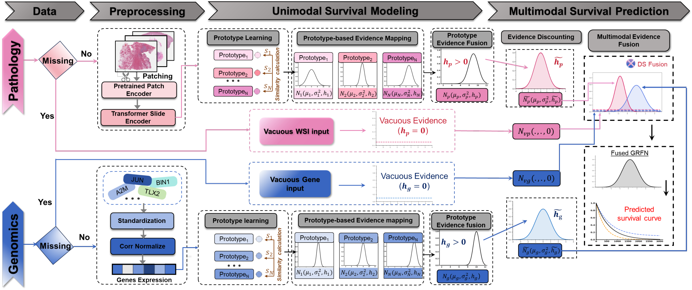

# EMMS

**Evidential Fusion Network for Multimodal Survival Prediction under Missing Modalities**, MICCAI 2026.

[arXiv](https://arxiv.org/abs/2606.20757) · [Cite](#cite)

EMMS fuses WSI and RNA survival evidence while treating missing modalities as vacuous evidence, providing uncertainty-aware predictions without imputing missing data.



## Installation

```bash
conda create -n emms python=3.10 -y
conda activate emms
pip install -r requirements.txt
```

## Data

Place inputs under `data/` for BRCA, LUAD, STAD, or KIRC:

```text
titan_embeddings/<patient_id>.pt                         # 768-d WSI features
data_csvs/rna/hallmarks/<CANCER>/rna_clean.csv             # gene expression
splits/survival/TCGA_<CANCER>_overall_survival_k=<0..4>/    # train.csv, test.csv
```

WSI features are not bundled. After obtaining access to [TITAN on Hugging Face](https://huggingface.co/MahmoodLab/TITAN) and authenticating, download and convert the released TCGA embeddings:

```bash
python scripts/prepare_titan_features.py
```

## Run

Run from the repository root:

```bash
# All four cohorts, 5-fold cross-validation
python scripts/run.py

# KIRC with 30% WSI and 30% RNA missing during training
python scripts/run.py --cancer_type KIRC --missing_config_train WSI:0.3_RNA:0.3
```

Results and checkpoints are saved under `results/` by cohort and missingness setting. Use `--output_dir` for a separate run directory. Metrics include C-index, IBS, and NBLL.

See [the configuration](configs/default_config.py) for defaults, [the notebook](scripts/pipeline.ipynb) for a worked example, or `python scripts/run.py --help` for options.

## Cite

```bibtex
@inproceedings{xing2026emms,
  title={Evidential Fusion Network for Multimodal Survival Prediction Under Missing Modalities},
  author={Xing, Yucheng and Mo, Hailan and Wang, Zi and Huang, Ling and Feng, Mengling},
  booktitle={Medical Image Computing and Computer Assisted Intervention -- MICCAI 2026},
  year={2026}
}
```

## Acknowledgements

WSI embeddings come from [TITAN](https://github.com/mahmoodlab/TITAN). Its released TCGA features are licensed under CC-BY-NC-ND 4.0 for non-commercial academic use.
